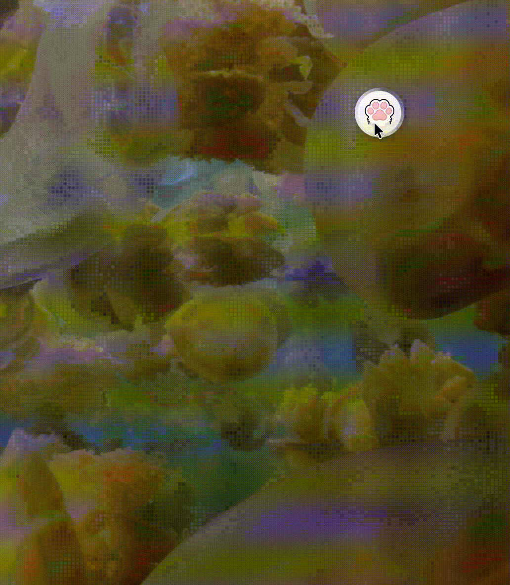
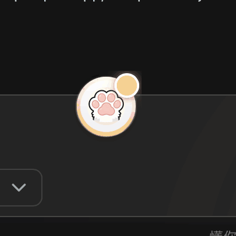
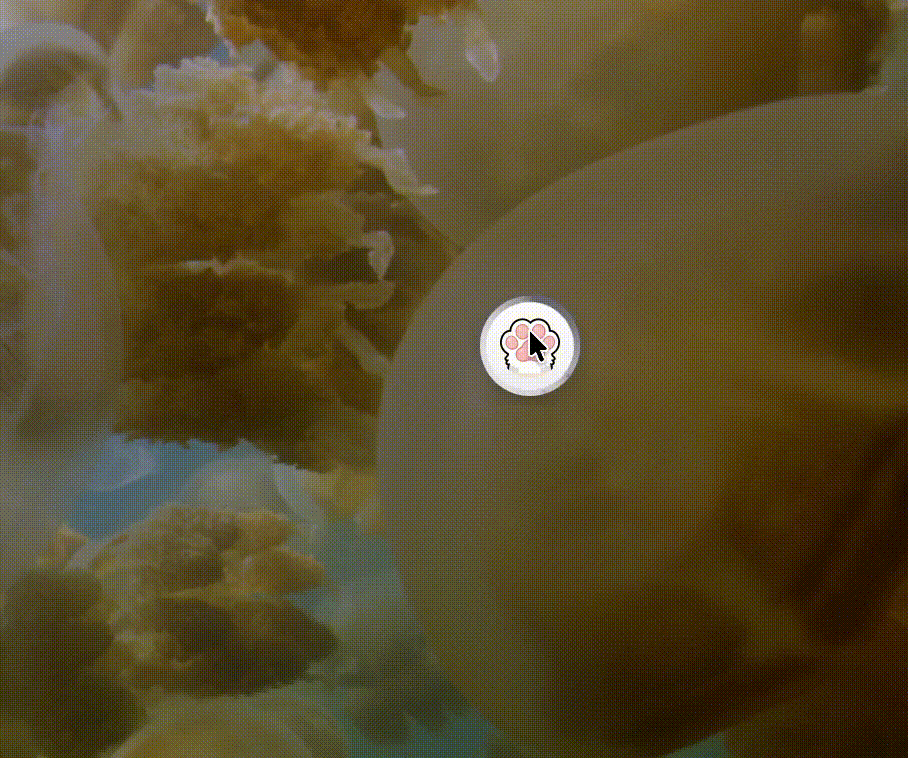
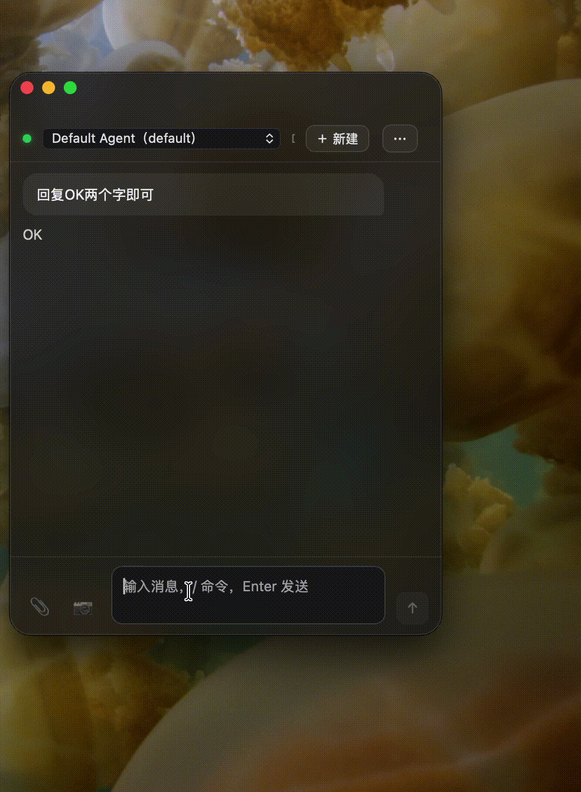
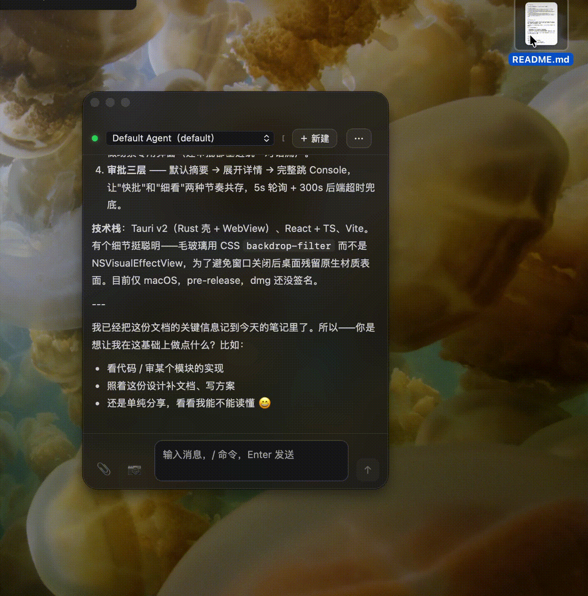

# Paw Pad v1.0.0 — QwenPaw 的轻量桌面入口

> 全局快捷键呼出，浮球常驻桌面，专注「即时交互」这一件事。

**Paw Pad 是 [QwenPaw](https://github.com/agentscope-ai/QwenPaw) 的桌面薄壳**：不自建 Agent、不跑模型、不打包后端——所有 Agent 能力来自运行在 `localhost:8088` 的 QwenPaw。Console 负责配置与管理，Paw Pad 负责「问一句话」的即时体验。

<p align="center"></p>

---

## ✨ 功能一览

### 🪟 桌面浮球

<p align="center">
  
  &nbsp;
  
</p>

- 50px 常驻浮球，始终置顶；拖动 + 角落吸附 + 位置记忆
- 单击呼出主窗口（Dock 式三段接力动画）；右键弧形菜单：置顶 / 新建 / 隐藏 / 退出
- 拖文件到浮球 = 直接喂 Agent
- 七态通知（浮球即桌面通知中心）：生成中=蓝 / 审批=黄 / 完成=绿 / 错误=红

### 💬 轻量对话

<p align="center"></p>

- 信息精简：用户消息 + 最终答案 + 工具摘要；工具参数默认收起、可展开；推理过程过滤
- 流式 SSE 渲染；统一对话流——审批也在消息流里，不做场景专用弹窗
- 自定义 Markdown 渲染（零依赖）；历史消息最近 20 条

### ⌨️ Slash 命令

纯复用 QwenPaw Console 的 `/` 命令体系——Paw Pad 只做识别前缀 + 透传 + 渲染，不自建命令。

### 📎 文件交互

<p align="center"></p>

- `@` 搜索补全（范围 Desktop / Documents / Downloads，fuzzy 匹配）
- 拖拽 / 粘贴统一走上传接口，文件用名字做 chip（不塞缩略图）

### 📷 截图

📷 按钮 / `⌘⇧X` → 系统选区截图 → 剪贴板 → chip → 输入框聚焦等补话。Agent 自主截图走 QwenPaw 后端的 `desktop_screenshot` 工具。

### ✅ 审批卡片

三层设计：默认层（摘要 + 批准 / 拒绝）→ 展开层（详情）→ 完整详情跳 Console；5s 轮询 + 对话流后补拉；300s 后端超时兜底。

### 🔌 连接体系

启动自动搜索 `localhost:8088` + 常见端口扫描；找不到时一次性 onboarding 引导输入；状态灯绿 = SSE 正常 / 灰 = 断开（hover 显示原因 + 重试）；自动重连。

### ⚡ 快捷键

`⌘⇧Space` 呼出 / 缩回 · `⌘⇧X` 截图 · 主窗口角落面板可重设（点击录制 + 冲突检测 + 恢复默认）。

### 🗂 信息架构

高频在弧形菜单（置顶 / 新建 / 隐藏 / 退出），低频收角落面板（顶栏「⋯」：连接设置 / 导出日志 / 快捷键设置 / 检查更新 / 关于）。

### 📋 日志

三级（ERROR / WARN / INFO）本地落盘 `~/Library/Logs/QwenPaw轻量助手/`，按日轮转、保留 7 天；**不记录对话内容 / token / 密码**。

---

## 📥 下载与安装

**前置依赖**：

- [QwenPaw](https://github.com/agentscope-ai/QwenPaw) 后端运行在 `localhost:8088`——Paw Pad 是纯前端壳，没有后端，必须先有 QwenPaw
- macOS 15+ / Apple Silicon（M 系列芯片；Intel Mac 暂不支持）

**安装步骤**：

1. 下载 [`Paw.Pad_1.0.0_aarch64.dmg`](https://github.com/yylxdzz/Paw-Pad/releases/download/v1.0.0/Paw.Pad_1.0.0_aarch64.dmg)（6.4 MB）
2. 拖入 Applications
3. **首次打开：在访达中右键点击 Paw Pad →「打开」→ 弹窗里再点一次「打开」**（当前版本未签名 / 未公证，这是未签名应用的正常提示；或前往「系统设置 → 隐私与安全性」底部点「仍要打开」）

## 🔐 文件校验

```
SHA256 (Paw.Pad_1.0.0_aarch64.dmg) = 66ccb0dc8a93c12ad87c7780142cb6e4abfe96270b606b46e3be45afbb4c1f92
```

## ⚠️ 已知问题与限制

- **未签名 / 未公证**：打开方式见上；签名 + 公证需要 Apple Developer Program（$99/年），等项目站稳再说
- **仅 macOS 15+ / Apple Silicon**：Windows 计划通过 GitHub Actions CI 交叉构建，暂未支持
- **单实例**：暂只连接一个 QwenPaw 实例，多实例跟随暂不支持
- **测试覆盖**：vitest 17/17 通过；部分 wdio e2e 用例为已知搁置项

## 🙏 致谢

- 一切 Agent 能力来自 [QwenPaw](https://github.com/agentscope-ai/QwenPaw)（AgentScope 团队出品）——Paw Pad 是它的桌面入口，不是独立产品
- 浮球、弧形菜单、审批流等桌面 Agent 交互形态参考了 [Agentero](https://github.com/poco-ai/Agentero) 的设计

---

*Paw Pad 以 [MIT](https://github.com/yylxdzz/Paw-Pad/blob/master/LICENSE) 协议开源。*
