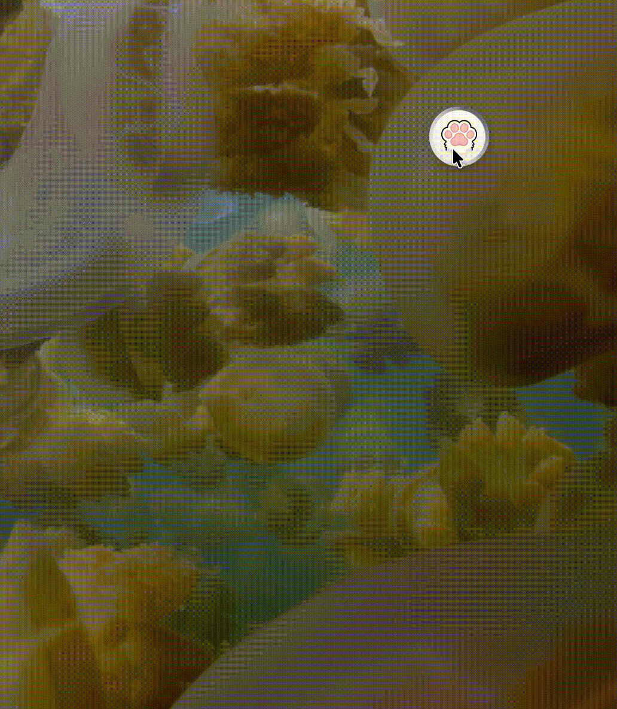
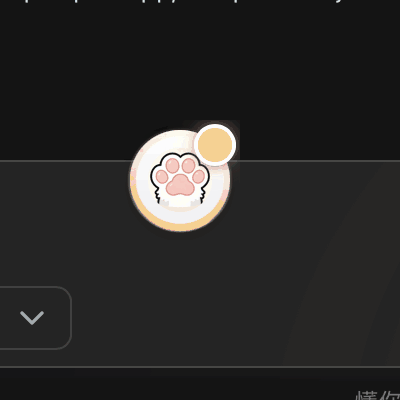
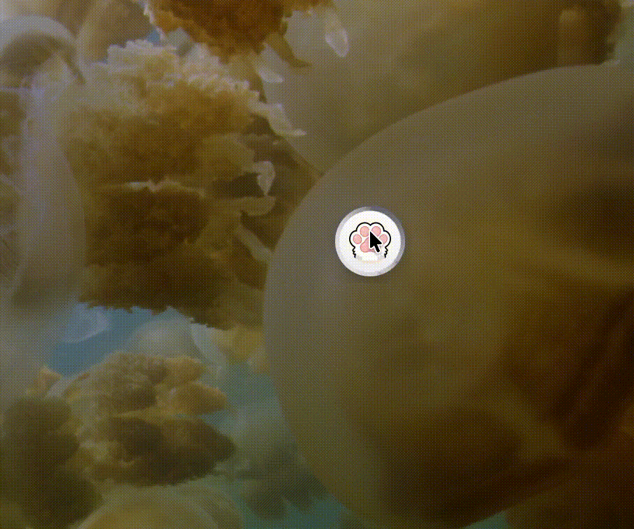
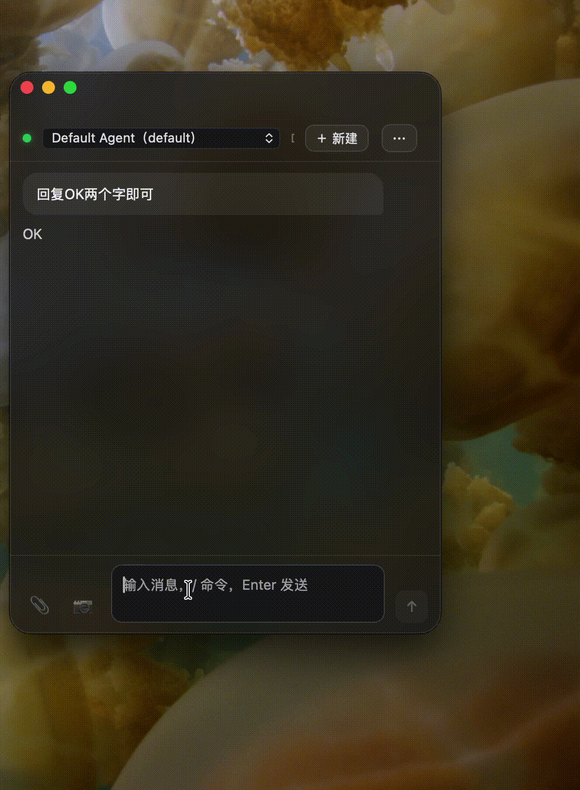
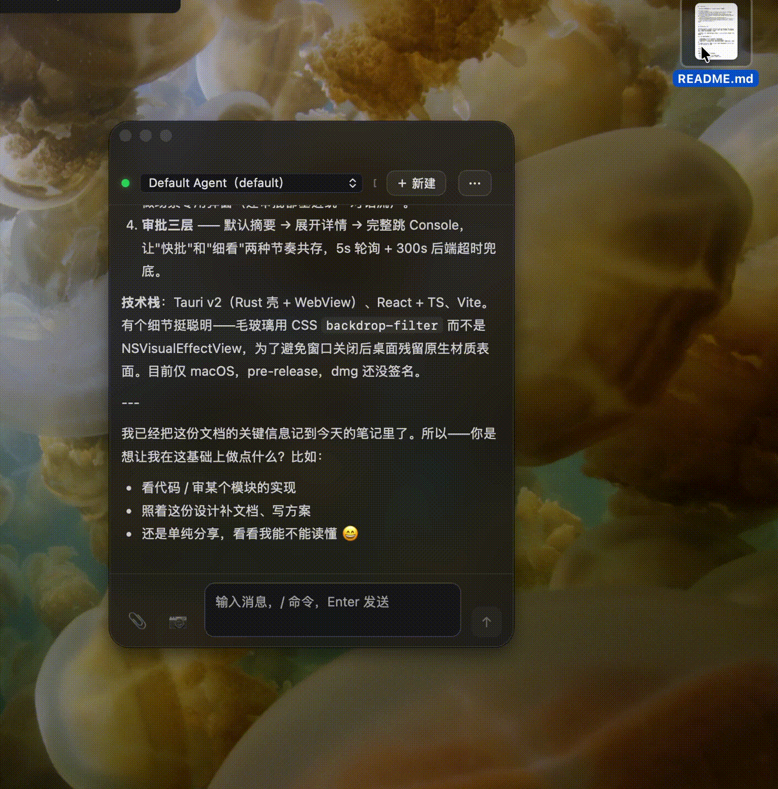

# 🐾 Paw Pad

> QwenPaw 的轻量桌面入口 — Console 的补充，不是替代。

<p align="center">
  <a href="LICENSE"></a>
  <a href="https://github.com/agentscope-ai/QwenPaw"></a>
  
  <a href="https://github.com/yylxdzz/Paw-Pad/releases/latest"></a>
  
</p>

<p align="center"></p>

<p align="center"><a href="https://github.com/yylxdzz/Paw-Pad/releases/latest"><b>⬇️ 下载 DMG（v1.0.0 · 6.4 MB）</b></a> — 未签名应用，首次打开请<b>右键 →「打开」</b>（详见下方「关于签名」）</p>

---

## 为什么做 Paw Pad

[QwenPaw](https://github.com/agentscope-ai/QwenPaw) 的 Console 是一个功能完整的 Web 管理面——多 Agent 编排、配置、会话管理、日志查看都在那里。它很好，但日常用起来有一个摩擦：

**每次想问一句话，都要切到浏览器、找到那个 localhost:8088 的标签页、等页面加载。**

Paw Pad 想解决的就是这一下：

- **全局快捷键 ⌘⇧Space** 随时呼出，不用找浏览器
- **浮球常驻桌面**，点一下就出来，拖个文件进去就开问
- **轻量对话**：只给你看用户消息、最终答案和工具摘要，参数默认收起——不堆信息
- **不替代 Console**：配置、多 Agent 管理、复杂运维还在 Console；Paw Pad 只管「即时交互」这一件事

---

## 核心功能

### 🪟 浮球

桌面常驻的 50px 圆形浮球，始终置顶。

<p align="center"></p>

<p align="center"></p>

- **单击呼出**主窗口（Dock 式三段接力动画）
- **右键弧形菜单**：置顶 / 新建 / 隐藏 / 退出
- **拖文件投放**到浮球 = 直接喂给 Agent
- **七态通知**：常态 / 生成中（蓝） / 审批待审（黄） / 任务完成（绿） / 错误（红） / 拖动中 / 拖入态——浮球就是你的桌面通知中心
- 拖动 + 角落吸附 + 位置记忆

### 💬 轻量对话

<p align="center"></p>

- **信息精简**：用户消息 + 最终答案 + 工具摘要；工具参数默认收起，可展开；推理过程过滤掉
- **统一对话流**：所有场景（含审批）都在消息流里，不做场景专用弹窗
- **自定义 Markdown 渲染**：零依赖最小化渲染器，只支持界面所需格式
- **历史加载**：最近 20 条 + 过滤

### ⌨️ Slash 命令

纯复用 QwenPaw Console 的 `/` 命令体系——Paw Pad 只做识别前缀 + 透传 + 渲染，不自建命令。

### 📎 文件交互

<p align="center"></p>

- **@ 搜索补全**：输入 `@` 触发，范围 Desktop / Documents / Downloads，Rust glob + fuzzy 匹配
- **拖拽 / 粘贴**：统一走 `POST /api/console/upload`
- 文件用名字做 chip（不塞缩略图）

### 📷 截图

- 📷 按钮 / `⌘⇧X` → 系统选区截图 → 剪贴板 → chip → 输入框聚焦
- Agent 自主截图走 QwenPaw 后端的 `desktop_screenshot` 工具，App 不做

### ⚡ 快捷键

- `⌘⇧Space` 呼出 / 缩回
- `⌘⇧X` 截图
- 主窗口角落面板可重设（点击录制 + 冲突检测 + 恢复默认）

### 🔌 连接体系

- **自动搜索**：默认试 `localhost:8088`，连不上扫常见端口
- **首次引导**：找不到时一次性 onboarding 输入地址
- **状态灯**：顶栏 Agent 名前绿 = SSE 正常 / 灰 = 断开（hover 显示原因 + 重试）
- **自动重连**

### ✅ 审批卡片

- 三层设计：默认层（摘要 + 批准/拒绝）→ 展开层（详情）→ 完整跳 Console
- 轮询 `GET /api/console/push-messages`（5s 定时 + 对话流后补拉）
- 300s 后端超时兜底

### 📋 日志

- 三级：ERROR / WARN / INFO
- 本地文件 `~/Library/Logs/QwenPaw轻量助手/`，按日轮转，保留 7 天
- Rust 原生事件 + 前端 UI 事件合并同一文件
- 角落面板「导出日志」
- **不记录对话内容 / token / 密码**

### 🗂 信息架构

- **弧形菜单**（右键浮球）= 高频 4 项：置顶 / 新建 / 隐藏 / 退出
- **角落面板**（顶栏「⋯」）= 低频收纳：连接设置 / 导出日志 / 快捷键设置 / 检查更新 / 关于

---

## 架构

**薄壳复用，不打包后端。** Paw Pad 是连接 QwenPaw 的前端壳，三层：

```
QwenPaw 后端（localhost:8088，不改）
        ↕  SSE / REST
App 原生壳（Rust / Tauri）
  快捷键 · 窗口 · 截图 · 浮球 · 文件拖拽 · 通知 · 日志
        ↕
App WebView 前端（React + TS）
  SSE 消费 · 对话渲染 · Slash · Chip · 审批 · 信息过滤
```

全部 Agent 能力来自 QwenPaw 后端——Paw Pad 不自建 Agent，不跑模型，不存会话状态（持久化靠后端）。

---

## 技术栈

- **Tauri v2**（Rust 原生壳 + WebView）
- **React + TypeScript**（前端 UI）
- **Vite**（构建）
- **CSS `backdrop-filter`** 毛玻璃——原生侧只保留 transparent 窗口 + 阴影开关，不用 NSVisualEffectView / Liquid Glass（避免窗口关闭后桌面残留原生材质表面）
- **libobjc runtime** 原语（浮球置顶 / 红绿灯按钮操作等原生交互，零新增依赖）

> 目前仅 macOS（Apple Silicon）。Windows 计划通过 GitHub Actions CI 交叉构建，暂未支持。

---

## 快速开始

### 前置依赖

- **[QwenPaw](https://github.com/agentscope-ai/QwenPaw)** 后端运行在 `localhost:8088`（Paw Pad 没有后端，必须先有 QwenPaw）
- macOS 15+ / Apple Silicon（M 系列芯片；Intel Mac 暂不支持）
- Node.js + [pnpm](https://pnpm.io)
- Rust toolchain（`rustup`）

### 开发运行

```bash
pnpm install
pnpm tauri dev
```

### 从源码构建

```bash
pnpm install
pnpm tauri build      # 产出 dmg
```

> **关于签名**：当前版本 **未做代码签名 / 公证**——首次打开时 macOS 可能提示「无法验证开发者」，这是未签名应用的正常现象，不是安装包有问题。打开方式二选一：**① 推荐——在访达中右键点击 Paw Pad →「打开」→ 弹窗里再点一次「打开」**；② 或前往「系统设置 → 隐私与安全性」，在底部点「仍要打开」。签名 + 公证需要 Apple Developer Program（$99/年），等项目站稳再说。

---

## 设计原则

- **轻量优先**：无侧边栏 / 导航 / 多 Tab / 重设置面板，大量留白，不引重型组件库，动画少而精
- **需求驱动而非功能堆砌**：每个功能都对应一个真实使用场景
- **复用优于自建**：Slash 命令、Agent 能力、会话持久化全部复用 QwenPaw，Paw Pad 只做交互壳

---

## 致谢

- Paw Pad 的一切 Agent 能力来自 [QwenPaw](https://github.com/agentscope-ai/QwenPaw)（AgentScope 团队出品）——Paw Pad 是它的桌面入口，不是独立产品
- 浮球、弧形菜单、审批流等桌面 Agent 交互形态参考了 [Agentero](https://github.com/poco-ai/Agentero) 的设计

---

## License

[MIT](LICENSE)
